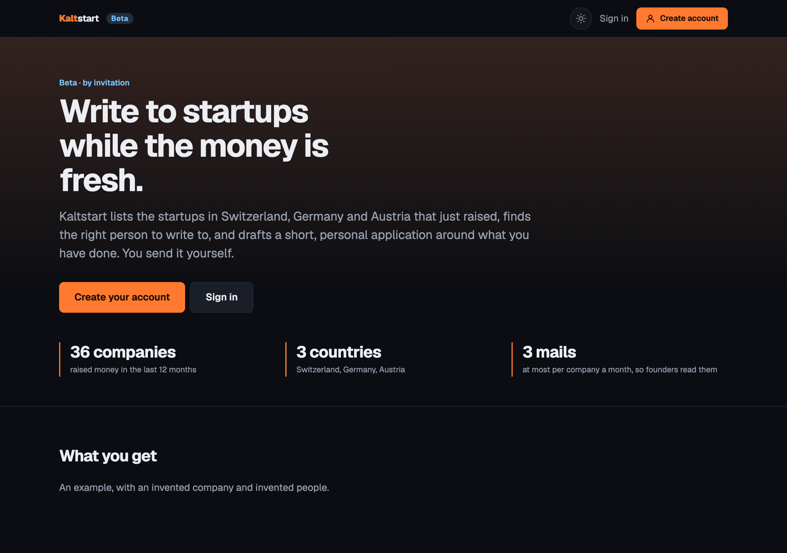
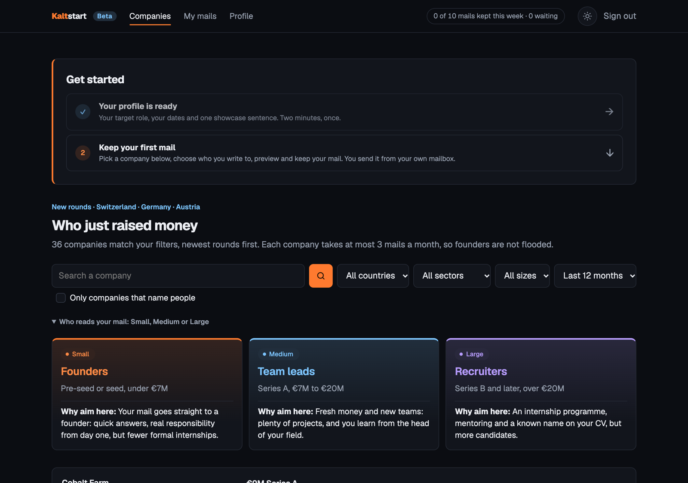
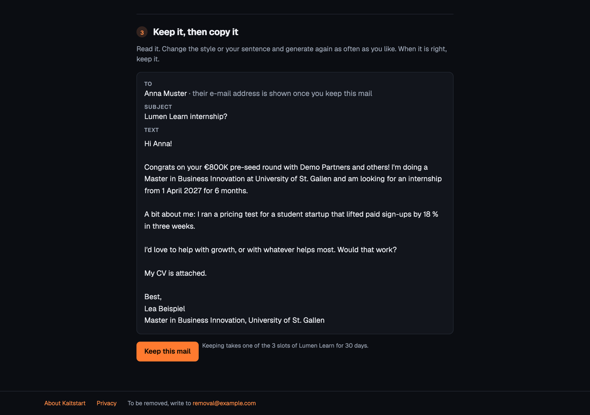
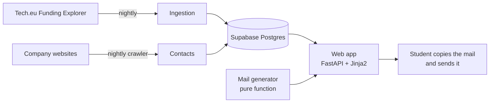

# Kaltstart

**Spontaneous applications to startups that just raised money.**

Students in Switzerland look for internships at young tech companies. The
best moment to write is right after a funding round: the company is about
to hire but has not posted a job yet. Finding those companies, the right
person and a good reason to write takes hours. Kaltstart does that part, and
leaves the student the part that gets them hired.

**Live beta, by invitation:** [kaltstart.onrender.com](https://kaltstart.onrender.com)
(the first load can take a minute: the free server sleeps).



## What it does

1. **Finds the companies.** Every night it loads the funding rounds of the
   last 12 months in Switzerland, Germany and Austria from the Tech.eu
   Funding Explorer.
2. **Finds who to write to.** A small crawler reads each company's own
   website (legal notice, team, contact pages) for a published address and
   for the people who lead a team or recruit.
3. **Drafts the mail.** From the student's profile and one sentence about
   something they did, it writes a short application that opens on the
   round, in English or German. The student edits it, copies it and sends it
   from their own mailbox.

| Pick a company | Read the draft, then keep it |
|---|---|
|  |  |

*Screenshots from the local demo mode: companies and people are invented.*

## Product decisions

The full log has 96 entries ([DECISIONS.md](DECISIONS.md)). The ones that
shaped the product most:

- **Fair to founders.** A company receives at most 3 mails from Kaltstart
  students in 30 days, and each student writes to it once. A student keeps
  at most 10 mails a week. (D5, D76, D95)
- **No mail is ever sent by the app.** The student sends it, from their own
  address. The e-mail address only appears once they commit to a mail, so
  the app cannot be used to harvest addresses. (D77)
- **No AI at runtime.** Mails come from templates and the student's own
  sentence, so every word is predictable and nothing is invented about
  anyone. ([PRD](PRD.md), sections 4 and 6)
- **A person found on a website is a suggestion.** The app shows the name,
  the title and the page it was read on; the student confirms it. Measured
  accuracy was 89 %, not enough to trust blindly. (D60)
- **A polite crawler.** It obeys `robots.txt`, waits 2 seconds between
  requests, reads at most 8 pages per company, never touches LinkedIn or
  any other site, and never guesses an address. Anyone can ask to be
  removed. (D27, D31, D32, [privacy page](https://kaltstart.onrender.com/privacy))

## How it works



| Part | Code | Runs |
|---|---|---|
| Ingestion of funding rounds | [`src/kaltstart/ingestion`](src/kaltstart/ingestion) | GitHub Actions, every night |
| Contact crawler | [`src/kaltstart/contacts`](src/kaltstart/contacts) | GitHub Actions, every night |
| Mail generator | [`src/kaltstart/mailgen`](src/kaltstart/mailgen) | inside the web app |
| Web app | [`src/kaltstart/api`](src/kaltstart/api) | Docker on Render (Frankfurt) |
| Database | [`supabase/migrations`](supabase/migrations) | Supabase (Paris), row-level security on every table |

Python 3.12, FastAPI, server-rendered pages with a few lines of JavaScript,
PostgreSQL. 1,558 automated tests, including the SQL functions on a local
PostgreSQL; no test touches the network.

## In numbers

Mid-November 2026:

- 832 funding rounds loaded on the first run; about 460 companies on the
  list (a round in the last 12 months and a website).
- Contact crawler, checked by hand against each company's site on 100
  companies it had never seen: an address found for 58 of the 75 companies
  that publish one (77 %), **no wrong address**, and people lists entirely right
  in 39 of 44 cases (89 %) ([measurements](docs/measurements/README.md)).
- Beta: a first group of students from two universities. The next step is
  20 to 30 students and their reply rate.

## How it was built

I am a business student at the University of St. Gallen and I do not write
code myself. I built Kaltstart as a product builder with
[Claude Code](https://claude.com/claude-code): I defined the product, wrote
and approved every specification, made the decisions in
[DECISIONS.md](DECISIONS.md), checked each result on real data and in the
live app, and Claude Code wrote the code under that direction, test first.

The working files of that process are part of the repository:

- [PRD.md](PRD.md): the product requirements.
- [`docs/superpowers/specs`](docs/superpowers/specs) and
  [`plans`](docs/superpowers/plans): one design and one plan per feature,
  written and approved before any code.
- [CLAUDE.md](CLAUDE.md): the project rules the assistant follows (privacy,
  crawler limits, test first).
- [DESIGN.md](DESIGN.md): the visual design system.
- [CHANGELOG.md](CHANGELOG.md): what changed, version by version.

## Run it

```
python3 -m venv .venv && source .venv/bin/activate
pip install -e ".[dev]"
pytest -q
python -m kaltstart.api --dev        # demo with invented data, invitation code "dev"
```

Deployment, the nightly jobs and removal requests are described in
[docs/operations.md](docs/operations.md).

## Data and privacy

Funding rounds: [Tech.eu Funding Explorer](https://funding.tech.eu/methodology),
licence CC BY 4.0. Addresses and people come only from each company's own
website. What the app keeps, why and for how long is on its
[privacy page](https://kaltstart.onrender.com/privacy). This repository and
its workflow logs never contain a person's name, an address or a page; test
fixtures are invented.

Kaltstart is a non-commercial student project. When the beta ends, all
personal data is deleted.
